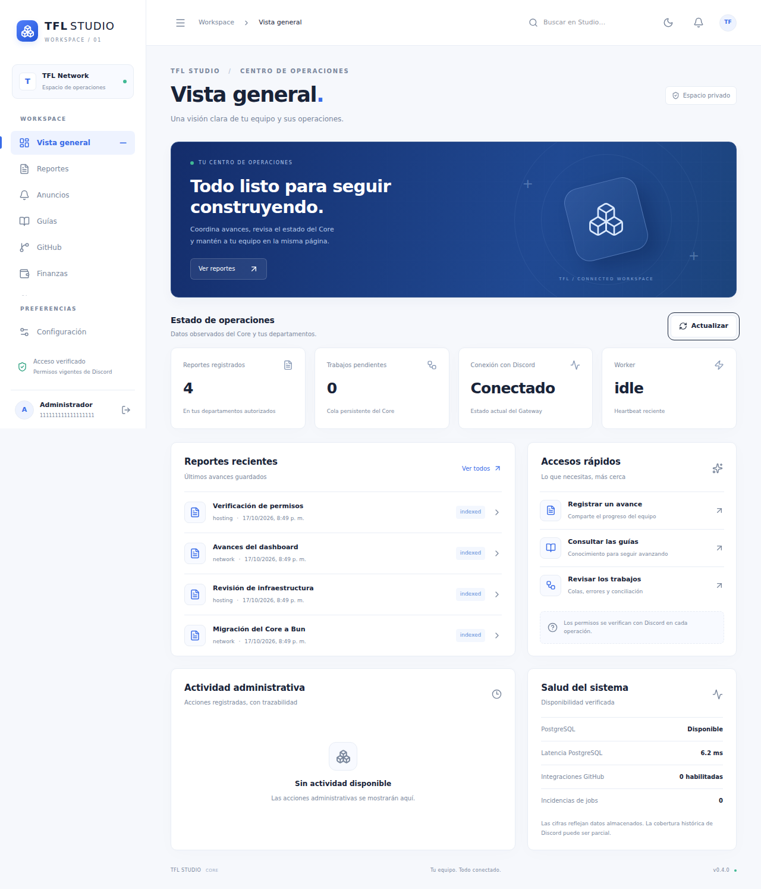

# TFL Studio 0.4 · Informe de revisión

**Estado:** implementación en rama de revisión; sin integración a main ni despliegue de producción. Rama: `rework/bun-monorepo-dashboard`. Base: `e7db70ab41dab0e818b63b275fa6f9d4fb4a1eed`.

## Resultado

Core y dashboard pertenecen ahora a un monorepo Bun. Se conservan los módulos operativos de 0.3, las 13 migraciones y las garantías de autorización, idempotencia, procedencia y conciliación. El dashboard administra rutas reales y conserva independencia de ejecución respecto al bot. La única migración nueva añade revisiones de contenido de anuncios.

Los cambios y comprobaciones por módulo están en [la matriz](REWORK_TRACEABILITY.md). El árbol y comunicación están en [Arquitectura](ARCHITECTURE.md). Los cuatro comandos se serializan y se registra su payload mediante una prueba REST simulada; no se registraron comandos en Discord real.

## Dashboard

Vistas: overview, reportes/publicidad, anuncios/plantillas, guías, GitHub fuentes/commits/releases, finanzas/registros/suscripciones/resumen, directorio/asignaciones, automatizaciones/notificaciones, jobs/conciliación, auditoría/snapshots/cobertura/importaciones/diagnóstico y preferencias.

Dispone de filtros, paginación, selección de columnas, edición con versiones, confirmaciones, errores/estados vacíos, temas y diseño móvil. Constructor de embeds diferido, previsualización aproximada, plantillas aplicables y contenido renderizado como texto seguro. Los datos visuales de las capturas proceden exclusivamente de la fixture de pruebas.

## Verificación local

| Comprobación | Resultado |
|---|---|
| Bun | 1.4.3 |
| PostgreSQL nativo | 16.14, aislado en loopback; también se comprobó inicialmente en 18.4 |
| Suite principal | 31 pruebas principales, sin omisiones con PG; conserva los subtests originales |
| Browser E2E | 6 flujos; Next → BFF → Core real → PG real, Discord simulado |
| Typecheck | Apps, paquetes, tests y scripts |
| Lint / formato / diff whitespace | Sin errores |
| Build Core | Bundle Bun, dependencias workspace externas |
| Build web | Next 16.4.2 / React 19.3.1, webpack, ejecutado con Bun |
| SQL 001–013 | Byte-idénticos a 0.3, comprobados por SHA256 |
| Upgrade 0.3→0.4 | Datos de guías/reportes/importes preservados; runner repetido |
| Instalación de Core filtrada y production | 95 paquetes; liveness Fastify verificado sin Next |
| Next dev | Login y redirección de ruta protegida verificados con webpack |
| Gateway / OAuth de Discord reales | Pendiente, no se emplearon credenciales operativas |
| Imagen Docker en FeatherPanel | Configurada, no construida/ejecutada en este entorno |
| Runtime Bun alojado en Vercel | Configurado 1.4.x; sin despliegue ni prueba alojada |

Playwright corrió mediante Node.js 24.19.0 en esta sesión. CI especifica Node 22 solo para ese runner; Core y los builds Next utilizan Bun. El Chromium local se obtuvo como binario empaquetado porque la descarga estándar estaba restringida; no es una dependencia del producto. PostgreSQL local requirió una adaptación de identidad del proceso por el entorno de pruebas de usuario único; CI usa el servicio PostgreSQL 16 normal.

Los 31 casos principales incluyen el registro simulado de comandos añadido al final. El contador Bun no desglosa como casos independientes todos los subtests heredados; no se eliminaron sus assertions.

## Rendimiento medido

Muestra sintética de un único proceso por variante: versión 0.3 con Node 24.19.0 + tsx frente al Core reestructurado con Bun 1.4.3. Endpoint público liveness, sin conexión a Discord o PostgreSQL, 20 peticiones de calentamiento y 200 secuenciales. No representa rendimiento bajo carga real del bot.

| Métrica | Node / base 0.3 | Bun / rework |
|---|---:|---:|
| Inicialización de módulos + API local | 553.75 ms | 320.90 ms |
| RSS observado después de la muestra | 143.74 MiB | 81.73 MiB |
| Latencia p50 | 1.548 ms | 0.202 ms |
| Latencia p95 | 1.738 ms | 0.329 ms |
| CPU en ventana de 500 ms de reposo | 2.447 ms | 7.491 ms |

No se atribuye mejora de CPU: esa ventana corta es ruidosa y Bun obtuvo un valor mayor. Tampoco se afirma mejora de Gateway, throughput SQL o estabilidad prolongada. Instalación/red/caché no se compararon en condiciones equivalentes. Datos exactos en BENCHMARK_SAMPLE.json; script reproducible scripts/benchmark.ts. El baseline inicial sin PostgreSQL pasó 17 casos y omitió 5 con ambos runtimes.

## Seguridad y límites deliberados

Las páginas y rutas consultan roles vivos; permisos globales permanecen exclusivamente en ADMIN. El BFF mantiene cookies en origen web, rechaza destinos/rutas arbitrarios, limita cuerpo y tiempo, preserva cookies OAuth y no filtra secretos al navegador. Los jobs humanos revalidan al solicitante antes de publicar. Los errores SQL de conflicto se presentan sin detalles internos.

No se hace exactamente-una-vez entre PostgreSQL y Discord: se conserva conciliación de resultados inciertos. Las guías enlazadas no sobrescriben automáticamente Discord. El histórico de anuncios previo a 0.4 no puede reconstruirse. El directorio es parcial. Los resúmenes financieros no convierten monedas y no simulan pagos bancarios. Las exportaciones son de la página. Las preferencias se guardan por navegador, no entre equipos.

El shell y las páginas verifican sesión en servidor; tablas y formularios administrativos son interactivos de cliente. La búsqueda global incluye navegación y reportes, no todos los contenidos de cada módulo. Las validaciones compartidas abarcan sesión, reportes y embeds; las demás rutas conservan sus esquemas de backend y OpenAPI.

## Despliegue y retorno

- [FeatherPanel](DEPLOY_FEATHERPANEL.md): imagen Bun, startup, red y bases privadas, health, apagado y actualización.
- [Vercel](DEPLOY_VERCEL.md): Root Directory apps/web, código externo de shared, instalación y build, variables servidor y OAuth por BFF.
- [Rollback](RECUPERACION.md): volver al código anterior manteniendo 014 aditiva y revisar jobs inciertos antes de reintentar.
- [Seguridad](SEGURIDAD.md): rotación de credenciales compartidas, sesiones y configuración privada.

No se usó, migró ni modificó la base de producción. No se publicaron mensajes ni se alteraron canales, roles o categorías. Las verificaciones operativas pendientes impiden declarar esta rama ya aprobada para producción.
